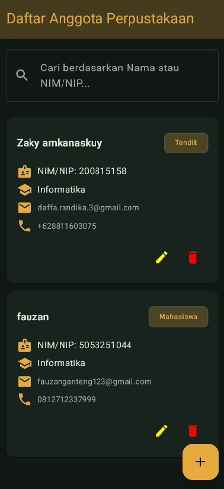
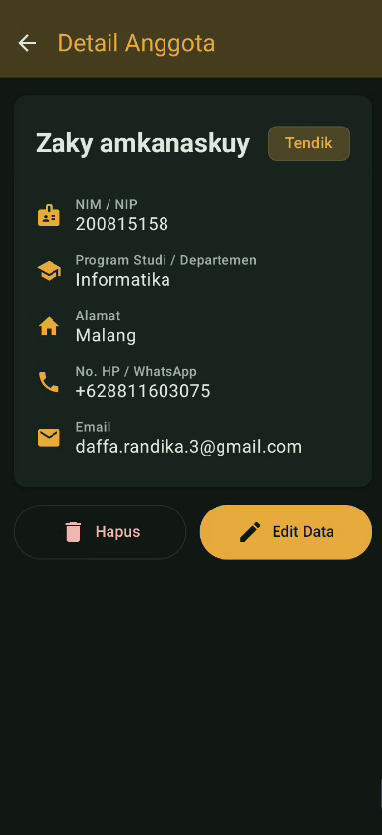
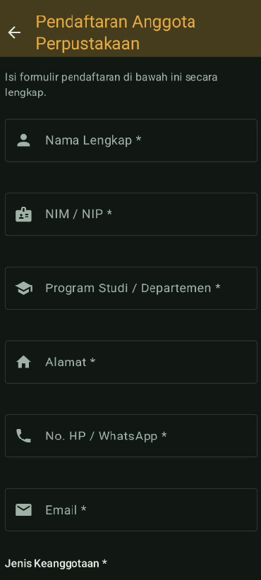
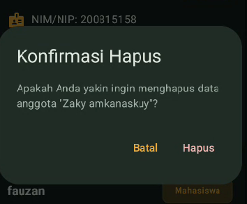

# Soal 1
**Studi Kasus & Ruang Lingkup Aplikasi LibraryReg**

---

**Studi Kasus**

Perpustakaan Utama Perguruan Tinggi "Nusantara" melayani ribuan mahasiswa dan staf pengajar aktif. Selama ini, pendaftaran anggota baru sepenuhnya bergantung pada formulir fisik kertas yang diisi manual di loket. Praktik ini menimbulkan serangkaian masalah operasional:

* **Pencegatan Alur Kerja & Antrean:** Pada awal semester baru, penumpukan calon anggota di loket menyebabkan antrean panjang dan membebankan kerja staf administrasi.
* **Integritas Data Rendah:** Kesalahan ketik saat pemindahan data manual dari kertas ke sistem internal sering terjadi, termasuk format email yang tidak valid dan NIM/NIP ganda.
* **Pencarian Lambat & Risiko Kehilangan:** Pencarian rekam data anggota secara fisik memakan waktu lama, serta berisiko data rusak atau hilang sebelum tersimpan digital.
* **Keterlambatan Layanan:** Pembuatan dan konfirmasi kartu keanggotaan membutuhkan waktu hingga beberapa hari kerja.

Untuk menyelesaikan permasalahan tersebut, dikembangkan **LibraryReg**, sebuah aplikasi Android yang mendigitalisasi proses registrasi mandiri dari sisi calon anggota sekaligus menyediakan fungsi pengelolaan data terpusat bagi petugas perpustakaan.

---

**Ruang Lingkup Aplikasi**

**Fitur & Batasan Ruang Lingkup**

* **Modul Pendaftaran (Pengguna/Calon Anggota):**
* Input data pendaftaran: Nama Lengkap, NIM/NIP, Program Studi, Alamat, Nomor Telepon, Email, dan Jenis Keanggotaan (Mahasiswa/Dosen/Tendik).
* Validasi input otomatis sebelum penyimpanan data (pengecekan kelengkapan *field* wajib, format penulisan email, dan keabsahan karakter NIM/NIP).

* **Modul Manajemen Data (Petugas Perpustakaan):**
* Display daftar seluruh anggota terdaftar (*List/RecyclerView*).
* Fitur pencarian (*search*) berdasarkan nama atau NIM/NIP secara real-time.
* Tampilan rincian (*detail view*) rekam data anggota.
* Fitur perbaruan data (*Edit/Update*) dan penghapusan data (*Delete*).

**Batasan Sistem (Out of Scope)**

* Aplikasi fokus pada manajemen data pendaftaran keanggotaan (CRUD) dan belum mencakup fitur sirkulasi peminjaman/pengembalian buku.
* Otentikasi multi-role komplit (seperti OAuth/SSO kampus) tidak dicakup pada versi dasar ini; antarmuka difokuskan pada alur input dan pengelolaan data lokal/basis data aplikasi.

# Soal 2
- List Member
  

- Detail Member
  

- Tambah Member
  

- Konfirmasi Ketika Menghapus Member
  

